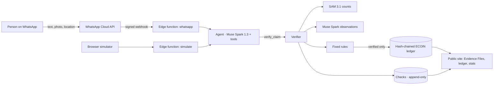

# ECO — the Climate Action OS

**ECO pays people for verified climate action, over WhatsApp, in any language. Meta AI checks every photo; fixed rules decide; a public, hash-chained ledger records every coin.**

> Climate action you can check — so climate change is never "a hoax" again.

[Live site](https://paulmalik431-ctrl.github.io/eco-climate-os/) · [Try the agent in your browser](https://paulmalik431-ctrl.github.io/eco-climate-os/try.html) · [Public ledger](https://paulmalik431-ctrl.github.io/eco-climate-os/ledger.html) · [Ghost Audit results](evals/README.md)

Built solo for the **Meta Global AI Developer Hackathon** (Startup track, theme: *Build for Your World*), Oct 26 – Nov 4, 2026. Everything in this repository was written during the event.

---

## The problem

Millions of people plant trees, clean streets and collect plastic. Almost none of it is paid, because nobody can check it cheaply. Climate money goes to whoever can afford auditors, and the people doing the work stay poor. When results can't be checked, people stop believing them.

## What ECO does

1. **Report on WhatsApp.** "I planted a tree." Text or photo, any language.
2. **The agent collects the evidence.** Muse Spark 1.3, using tool calls, asks for exactly what is missing: a photo, a before-and-after pair, or a location.
3. **Meta AI looks.** SAM 3.1 finds and counts saplings, litter, bottles and cans. Muse Spark answers fixed questions: same place? still alive? edited?
4. **Rules decide, not the model.** The verdict is *verified*, *needs better evidence* or *contradicted*, with plain reasons. Unclear evidence is never treated as an accusation.
5. **ECOIN is paid on a public ledger.** Each entry is hash-chained to the last, so anyone can re-check the whole chain in their browser.

Every claim gets a public **Evidence File**: the photos with SAM's boxes drawn on them, what Muse Spark saw, the rule decision and the ledger entry.

## The design rule: the AI can look and talk, only rules can pay

The agent has no tool that moves money. Its only route to a payment is `verify_claim`. That tool:
- refuses unless the evidence is complete;
- runs SAM 3.1 and Muse Spark;
- applies the protocol's fixed rules;
- credits the protocol's reward, never an amount the model chooses.

The tests prove this: a model that calls `verify_claim` too early gets nothing (`tests/agent.test.ts`).

## How ECO uses Meta

| Meta technology | What it does in ECO | Code |
|---|---|---|
| **WhatsApp Cloud API** | Where people live: intake, replies, media, location pins | `_core/whatsapp.ts`, `functions/whatsapp` |
| **Muse Spark 1.3**, tool calling | The agent: multilingual conversation that drives each claim through 6 tools | `_core/agent.ts` |
| **Muse Spark 1.3**, vision + JSON schema | Answers each protocol's yes/no/unclear questions across photos | `_core/verify.ts` |
| **SAM 3.1** | Counts saplings, litter, bottles and cans; counts drive rewards; boxes drawn on Evidence Files | `_core/sam.ts`, `_core/verify.ts` |
| **Muse Image** | Ghost Audit: generates fraudulent evidence to attack our own checks | `scripts/ghost-audit.ts` |
| **Muse Voice Transcribe** | Voice-note claims (WAV path; WhatsApp's Opus notes are on the roadmap) | `_core/meta.ts` |

Only Standard-mode models are used. `-contributor` models, which can train on data, are refused in code.

## What ECO pays for (protocols are data, not code)

| Action | Evidence | Reward |
|---|---|---|
| Tree planting | Photo + location | 100 ECOIN, then **400** if the tree is alive 30+ days later within 50 m |
| Cleanup | Before + after photos + location | 50 + 10 per item SAM counts removed (max 300) |
| Recycling | One photo of bottles and cans | 5 per item SAM counts (max 200) |

To add a new action, write one entry in `_core/protocols.ts`. The agent, verifier, Evidence Files and ledger all pick it up.

## Architecture



- **Backend:** Supabase. Postgres with row-level security, append-only triggers, a SQL `ledger_append` that hashes the same way the browser checks, public read-only views, Storage, and Deno Edge Functions.
- **Web:** static pages on GitHub Pages. They read only the public views and never see phone numbers.
- **Core:** plain TypeScript in `supabase/functions/_core`. It runs the same in Deno (production), Bun (tests and scripts) and the browser (ledger check).

## Trust and safety

- **Consent first.** Nothing is checked until the person agrees that their photos and location become a public Evidence File.
- **Pseudonyms.** People appear as IDs like `eco_3f9a…`. Phone numbers stay in a private table.
- **No accusations.** Ambiguous evidence is "needs better evidence", and the agent says which photo would settle it. Only *confident* answers on *hard* questions can contradict a claim.
- **Tamper evidence.** Checks and ledger entries can't be updated or deleted (database triggers). The ledger is hash-chained, and anyone can verify it.
- **Replay and fraud checks.** These catch reused photos (SHA-256), follow-up photos taken more than 50 m away, follow-ups that come too early, and signs of AI generation or editing.
- **Cost caps.** Per-person and global daily limits apply to messages and verifications.
- **ECOIN is a test ledger** in this build, not a token for sale.

## Run it

```bash
bun test                            # 30+ tests: SAM parser, rules, ledger, agent, WhatsApp — offline, no API cost
MODEL_API_KEY=... bun run dev       # local site + live agent at http://localhost:8787
MODEL_API_KEY=... bun run audit     # Ghost Audit (Muse Image fakes vs. the verifier)
```

To deploy (Supabase, WhatsApp test number, GitHub Pages), see [docs/SETUP.md](docs/SETUP.md).

## Roadmap

- **Merchants accept ECOIN.** Shops that take ECOIN earn carbon-credit-linked incentives.
- **Face pay with a WhatsApp code as backup.** No card and no phone needed at checkout. No photos stored, and nothing biometric on the ledger.
- **Voice-note claims** in any language: convert WhatsApp Opus to WAV, then Muse Voice Transcribe.
- **More protocols:** clean cookstoves, solar installs, mangrove restoration.
- **Funder reports:** the verified actions behind each payout, exported for climate-finance buyers.

## License

MIT. See [LICENSE](LICENSE).
