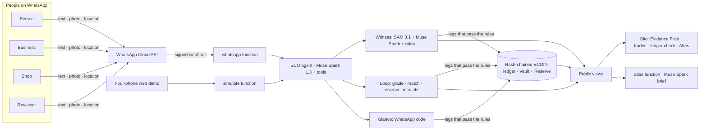

# ECO · Proof of Planet

**ECO makes climate action attractive, and tradeable.**
Bitcoin is mined with electricity. **ECOIN is minted by Proof of Planet**: you earn it for verified climate action, trade it for recyclables and spend it in shops. Everything happens on WhatsApp, in any language, and Meta AI checks the evidence.

[Live site](https://paulmalik431-ctrl.github.io/proof-of-planet/) · [Live demo, four phones](https://paulmalik431-ctrl.github.io/proof-of-planet/try.html) · [Atlas](https://paulmalik431-ctrl.github.io/proof-of-planet/atlas.html) · [Public ledger](https://paulmalik431-ctrl.github.io/proof-of-planet/ledger.html) · [Ghost Audit](evals/README.md)

Built solo for the **Meta Global AI Developer Hackathon** (Startup track, theme *Build for Your World*), Oct 26 – Nov 4, 2026. Everything in this repository was written during the event (see [What was built when](#what-was-built-during-the-hackathon)).

---

## The problem

Climate action and payments are broken for most people:

- **Unverified.** Funders can't trust the evidence, so they check it by hand or don't pay.
- **Unpaid and unbanked.** The people doing the work rarely earn from it, and 1.4 billion adults have no bank account (World Bank Global Findex 2021).
- **Costly and hard to use.** Cards and payment platforms charge high fees and are hard for first-time users.
- **Untradeable.** Climate waste and verified action have no simple market.

ECO fixes all four.

## Earn it. Trade it. Spend it. Fund it.

| | Engine | What it does | Meta |
|---|---|---|---|
| **Earn** | **Witness** | You plant a tree, clean up a place or recycle, then send photos on WhatsApp. SAM 3.1 counts what matters and Muse Spark answers fixed questions. Fixed rules decide the result: *verified*, *needs better evidence* or *contradicted*. Only a verified result mints ECOIN. No proof, no token. | SAM 3.1, Muse Spark 1.3 |
| **Trade** | **Loop** | People sell sorted bottles, recyclable plastic jerrycans, cans, cardboard and e-waste to businesses. SAM counts the lot, Muse Spark grades it, and eligible buyers set the price with bids. ECOIN stays in **escrow** until the buyer records accepted intake; the seller is paid only for that amount. If there's a dispute, Muse Spark recommends a settlement and **a person decides**. | SAM 3.1, Muse Spark 1.3 |
| **Spend** | **Glance** | You pay in shops, on buses and in apps with no card and no cash. The shop types your number, and you confirm with the one-time **WhatsApp code**. Face confirmation is on the roadmap, with no face database. | WhatsApp |
| **Fund** | **Atlas** | Verified data becomes a live map and a brief for funders: what to fund, where action is needed and where the risk is. It is written by Muse Spark from public numbers only. | Muse Spark 1.3 |
| | **Vault** | The escrow, plus an audited **Reserve** built from 30% of every fee. Everything sits on a public, append-only, hash-chained ledger. | |

All four engines run through one agent: **ECO on WhatsApp**, which is Muse Spark 1.3 with tool calling, using a different set of tools for a person, a business, a shop and a reviewer.

## The design rule: the AI can look and talk, only rules can move money

The model chooses which tool to call. The tools enforce the rules, and ECOIN moves through exactly four gates:

1. **Mint** (`verify_claim`): only after Witness finds the evidence consistent. The amount comes from the protocol, never from the model.
2. **Escrow** (`accept_offer`): only from the buyer's own balance.
3. **Release** (`confirm_delivery`, `resolve_dispute`): only when the buyer confirms delivery, or a human reviewer decides a dispute they are not part of.
4. **Pay** (Glance): only with the customer's 6-digit WhatsApp code. The code is stored as a salted hash, expires in 5 minutes and allows 3 tries.

The ledger enforces the same rules twice, once in TypeScript (`checkLegs`) and once in SQL (`ledger_post`):
- minting can only credit;
- every transfer sums to zero;
- no account can go below zero;
- escrow is tracked per trade: a trade locks once and can never pay out more than it locked, so a repeated or simultaneous confirmation can't pay twice;
- every entry is hash-chained to the one before it and can't be updated or deleted.

The tests show that a model calling tools out of order gets nothing (`tests/agent.test.ts`, `tests/loop-glance.test.ts`).

## How ECO makes money

| Revenue | Rate | |
|---|---|---|
| Marketplace fees | 2% | on every Loop trade |
| Escrow fees | 1% | on every Loop trade |
| Payment fees | 1% | on every Glance payment, paid by the shop |
| Verification fees | per project | funds and developers pay for Witness checks and Atlas briefs |
| App revenue | today | advertising and Boost subscriptions in the ECO App |

30% of every fee goes to the **ECO Reserve**, which anyone can see on the ledger. **We earn from fees, not from ECOIN's price.**

## How ECO uses Meta

| Meta technology | Where | Code |
|---|---|---|
| **WhatsApp Cloud API** | Intake, replies, photos, location pins, messages between people, Glance codes | `_core/whatsapp.ts`, `functions/whatsapp` |
| **Muse Spark 1.3** with tool calling | The agent: 23 tools across four roles, in any language | `_core/agent.ts`, `_core/tools.ts` |
| **Muse Spark 1.3** with vision and JSON schema | Witness observations, Loop grading, dispute recommendations, Atlas briefs | `_core/verify.ts`, `_core/loop.ts`, `functions/atlas` |
| **SAM 3.1** | Counts saplings, litter, bottles and cans. The counts drive rewards and prices, and the boxes are drawn on Evidence Files | `_core/sam.ts`, `_core/verify.ts`, `_core/loop.ts` |
| **Muse Spark Open** (open weights, via Baseten) | Drop-in engine for the agent and all reasoning (`CHAT_PROVIDER=baseten`). If SAM 3.1 isn't available, counts come from the model's own estimate, and the record says so | `_core/meta.ts` (`clientFromEnv`) |
| **Muse Image** | Ghost Audit: generates fraudulent evidence to attack our own checks | `scripts/ghost-audit.ts` |
| **Muse Voice Transcribe** | Voice-note claims (WAV path ready; WhatsApp's Opus notes are on the roadmap) | `_core/meta.ts` |

Only Standard-mode models are used; `-contributor` models are refused in code. **Disclosure:** This hackathon build runs on Meta's free developer credits; under those terms Meta may use what is sent to its models to improve its products. People are told this in the consent message before anything is checked.

## Architecture



- **Backend:** Supabase. Postgres with row-level security, append-only triggers, `ledger_post` (atomic, overdraft-proof, hashes exactly like the browser), public read-only views, Storage, and Deno Edge Functions (`whatsapp`, `simulate`, `atlas`).
- **Core:** plain TypeScript in `supabase/functions/_core`. It runs the same in Deno (production), Bun (tests and scripts) and the browser (ledger check).
- **Web:** static pages on GitHub Pages that read only the public views.

## Trust and safety

- **Consent first.** Nothing is checked until the person agrees that their photos and location become a public Evidence File.
- **Pseudonyms only.** People appear as IDs like `eco_3f9a…`. Phone numbers stay private, and pickup points are rounded to about 1 km.
- **No accusations.** Unclear evidence becomes "needs better evidence", and the agent says which photo would settle it.
- **A person decides every dispute.** Both the AI's recommendation and the human decision are published on the trade page.
- **No face database, and nothing biometric on the ledger.** Meta's models are not face-recognition models. Face confirmation will plug into Glance (`FaceVerifier` in `_core/glance.ts`) only with a certified provider, consent and a data-protection impact assessment. Until then, Glance uses the WhatsApp code.
- **Fraud checks.** Reused photos are caught by SHA-256 across claims and listings. The checks also catch follow-ups far from the original spot or too early, possible AI-made images, lots that don't match the photo, and overdrafts.
- **Cost caps.** Each person and the public demo have daily limits.
- ECOIN in this build is a **test ledger**. Business test deposits are labelled on the ledger.

## Run it

```bash
bun test                                   # 55 tests: SAM parser, rules, ledger & fees, escrow invariants, Loop, Glance, agent, WhatsApp. Offline, no API cost.
MODEL_API_KEY=... bun run dev              # local site + live agent at http://localhost:8787
bun scripts/dev.ts --seed a.jpg b.jpg      # offline: a scripted earn → trade → spend story to explore the pages
MODEL_API_KEY=... bun run audit            # Ghost Audit (Muse Image fakes vs. Witness)
```

To deploy (Supabase, WhatsApp test number, GitHub Pages), see [docs/SETUP.md](docs/SETUP.md).

## What was built during the hackathon

This whole repository: the agent and its tools, Witness, Loop, Glance, Atlas, the ledger and Vault, the Supabase schema and functions, the web pages, the tests and the Ghost Audit. ECO and the ECO App existed before the event; none of their code is in this repository.

## Roadmap

- **Face confirmation for Glance** through a certified provider: 1:1 match on the customer's own enrolment, no face database.
- **Voice-note claims**: convert WhatsApp Opus to WAV, then Muse Voice Transcribe.
- **More protocols:** clean cookstoves, solar installs, mangrove restoration.
- **Carbon-credit incentives** for merchants who accept ECOIN.
- **Verification-as-a-service** for funds and developers, with Atlas briefs per project.

## License

MIT. See [LICENSE](LICENSE). Leaflet (BSD-2-Clause) is bundled in `web/vendor/leaflet`.
